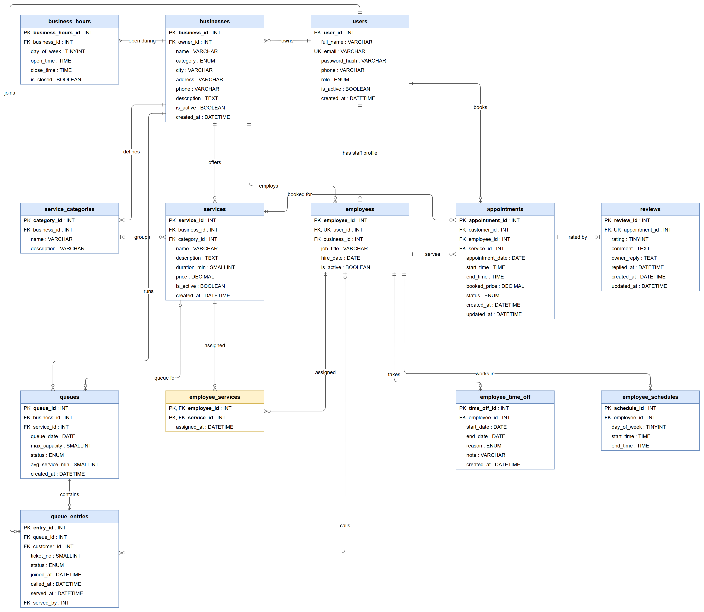

# Smart Queue & Appointment Platform

**Team BeeBooking** · BBF 302E Database Systems term project, Fall 2026

A web platform for service businesses such as hair salons, barbers, repair shops and service centers. Businesses
manage their services, staff, working hours, appointments and walk-in customers in one place. Customers can book
a service with the employee they prefer, or join a virtual queue and follow their turn remotely instead of waiting
at the shop.

## Features

- **Accounts and roles:** registration, login and role-based access for Admin, Business Owner, Employee, Customer and Guest
- **Businesses:** business profiles with opening hours, search by name, category and city
- **Services:** service catalog with categories, duration and price; services can be deactivated
- **Employees:** staff management, employee-service matching, weekly working hours and time off
- **Appointments:** pick a service, an employee and a free time slot; reschedule or cancel; appointment history
- **Reviews:** 1 to 5 star reviews for completed appointments, with an optional reply from the business owner
- **Virtual queue:** take a ticket, see your position and estimated waiting time; staff call the next customer; public queue display
- **Reports:** bookings and revenue per service, employee performance, waiting times and busiest hours, platform statistics

## Tech Stack

| Layer | Technology |
|---|---|
| Database | MySQL 8 (InnoDB) |
| DB driver | mysql-connector-python, **raw SQL only (no ORM)** |
| Backend | Flask (Python) |
| Frontend | Jinja2 templates and Bootstrap 5 |
| Authentication | Flask sessions, Werkzeug password hashing, role-based access control |
| Sample data | Python and Faker |

## Team

| Member | Student ID | Responsibility | Tables |
|---|---|---|---|
| Hüseyin Teke (Team Leader) | 150230089 | Authentication, user accounts, businesses, admin panel (FR-01 to FR-07) | users, business_owners, businesses, business_hours |
| Efe Karan Hacımustafaoğlu | 150240313 | Service catalog and employee-service matching (FR-08 to FR-14) | service_categories, services, employee_services |
| Daniel Ikeoluwa Akosile | 150220936 | Employees, working schedules and time off (FR-15 to FR-21) | employees, employee_schedules, employee_time_off |
| Yunus Kaan Öztürk | 150230107 | Appointment booking and reviews (FR-22 to FR-28) | appointments, reviews |
| Kerem Kavun | 150230014 | Virtual queues and queue statistics (FR-29 to FR-35) | queues, queue_entries |

## Data Model

The design has **14 related tables** (13 entities and 1 junction table). It contains one-to-one, one-to-many and
many-to-many relationships. The full schema with columns, data types, keys and constraints is in the
[Milestone 2 document](docs/milestone2/BBF302E_Milestone2_BeeBooking.pdf).



| # | Table | What it stores |
|---|---|---|
| 1 | `users` | All accounts and their roles |
| 2 | `business_owners` | Owner profile of a user: company title, tax number, verification (1:1 with users) |
| 3 | `businesses` | Salons, repair shops and service centers |
| 4 | `business_hours` | Weekly opening hours of each business |
| 5 | `service_categories` | Service categories of each business |
| 6 | `services` | Services with duration, price and status |
| 7 | `employee_services` | Which employee performs which service (M:N junction table) |
| 8 | `employees` | Staff profile of a user at a business (1:1 with users) |
| 9 | `employee_schedules` | Weekly working shifts of employees |
| 10 | `employee_time_off` | Vacation and sick leave periods |
| 11 | `appointments` | Bookings with date, time, booked price and status |
| 12 | `reviews` | Ratings, comments and owner replies of completed appointments (1:1 with appointments) |
| 13 | `queues` | Daily virtual queues of businesses |
| 14 | `queue_entries` | Customers waiting in queues |

Conceptual ER diagram in Chen notation: [overview](docs/milestone2/er_1a_overview.png) ·
[users and businesses](docs/milestone2/er_1b_users_businesses.png) ·
[staff and appointments](docs/milestone2/er_1c_staff_appointments.png) ·
[queues](docs/milestone2/er_1d_queues.png). Relational schema: [relational_schema.png](docs/milestone2/relational_schema.png).
The editable draw.io file is [docs/milestone2/BeeBooking_ER.drawio](docs/milestone2/BeeBooking_ER.drawio)
(open it at [app.diagrams.net](https://app.diagrams.net) with File > Open from > Device).

## Documents

| Milestone | Document |
|---|---|
| Milestone 1: Project proposal | [PDF](docs/milestone1/BBF302E_Milestone1_Proposal_BeeBooking.pdf) · [Word](docs/milestone1/BBF302E_Milestone1_Proposal_BeeBooking.docx) |
| Milestone 2: ER diagram and data model | [PDF](docs/milestone2/BBF302E_Milestone2_BeeBooking.pdf) · [Word](docs/milestone2/BBF302E_Milestone2_BeeBooking.docx) |

## Project Structure

```
app/
  __init__.py          Flask app factory
  db.py                MySQL connection and raw SQL helpers
  main.py              home page and /health database check
  templates/           Jinja2 templates (Bootstrap 5)
sql/
  create_database.sql  creates the database and the application user
docs/
  milestone1/          Milestone 1 proposal
  milestone2/          Milestone 2 document, draw.io ER diagram and its PNG exports
config.py              reads settings from .env
run.py                 starts the app
setup.ps1              one-time local setup (Windows)
requirements.txt
.env.example
```

Planned for the next milestones: one module per feature area (auth, businesses, services, employees,
appointments, queues), `sql/schema.sql` with all tables and constraints, and a Faker script for sample data.

## Setup

Requirements: Python 3.11 or newer, MySQL Server 8.

1. Clone the repository:
   ```bash
   git clone https://github.com/huseyinteeke/SmartQueueApointmentPlatform.git
   cd SmartQueueApointmentPlatform
   ```
2. Run the setup script in PowerShell. It creates the `.venv` virtual environment, installs the packages and
   creates a `.env` file with a random secret key:
   ```powershell
   .\setup.ps1
   ```
   On macOS or Linux: `python3 -m venv .venv`, `source .venv/bin/activate`, `pip install -r requirements.txt`,
   then copy `.env.example` to `.env`.
3. Open `sql/create_database.sql`, replace `change-me` with your own password, and run it as the MySQL root user:
   ```bash
   mysql -u root -p < sql/create_database.sql
   ```
4. Write the same password into `.env` as `DB_PASSWORD`.
5. Start the app:
   ```powershell
   .\.venv\Scripts\Activate.ps1
   flask run
   ```
6. Open http://127.0.0.1:5000/health. If you see `"status": "ok"`, the app is connected to MySQL.

## Milestones

- [x] **Milestone 1:** Project proposal and group formation (16.10.2026)
- [x] **Milestone 2:** ER diagram and data model design (due 22.11.2026)
- [ ] **Milestone 3:** Database implementation and Flask application (11.12.2026)
- [ ] **Milestone 4:** CRUD, complex queries, authentication, demo and documentation (22.12.2026)

## Contribution Rules

- Everyone commits **with their own GitHub account**, regularly. The repository is used to evaluate individual contributions.
- Work on a feature branch (e.g. `feature/appointments`) and open a pull request to `main`.
- Write clear commit messages (e.g. `Add service create form and INSERT query`).
- Never commit `.env`, `.venv` or database passwords.
